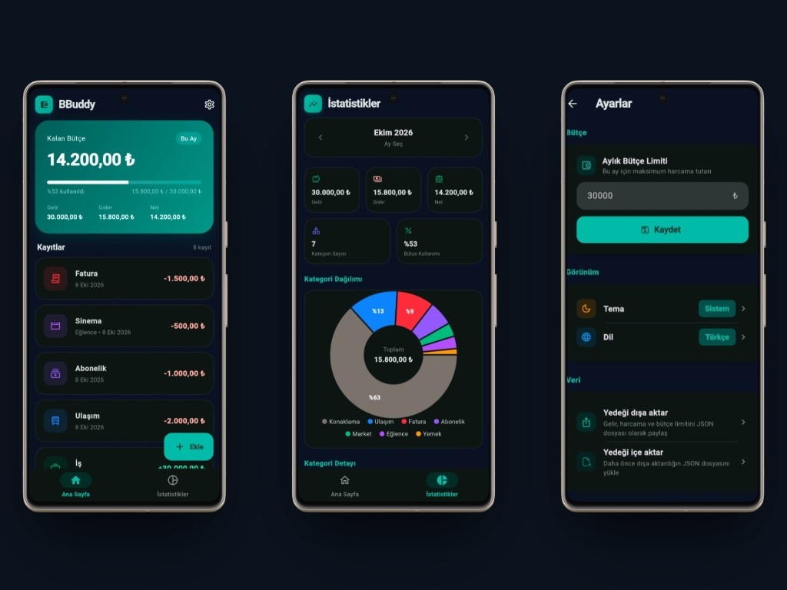

# BBuddy

<p align="center">
  
  
  
  
</p>

<p align="center">
  <strong>Üniversite öğrencisinin ayı, telefonunda kalsın.</strong><br />
  Harcama, gelir ve aylık limit. Hesap yok, reklam yok, internet yok.
</p>

<p align="center">
  
</p>

BBuddy, harçlık, burs, yurt, market ve abonelik gibi öğrenci harcamalarını takip etmek için yapılmış sade bir bütçe uygulamasıdır. Ayın başında bir limit belirlersin. Gelen parayı ve giden parayı kaydedersin. Kalan tutar, kullanım oranı ve net durum ana ekranda durur.

Bankana bağlanmaz. Bir sunucuya yazmaz. Girdiğin her şey cihazında kalır.

## Ne görürsün

- **Ana sayfa.** Kalan bütçe, bu ayın geliri, gideri ve neti. Kayıtlar tarih sırasıyla altta.
- **İstatistikler.** Ay seç, kategorilere göre pastayı gör, limitin ne kadarının gittiğini oku.
- **Ayarlar.** Limiti değiştir, temayı ve dili seç, yedeği JSON olarak al veya geri yükle.

## Özellikler

- Gelir ve gider ekleme, düzenleme, silme. Not, tutar, kategori ve tarih.
- İlk açılışta aylık bütçe sorusu. Limiti daha sonra ayarlardan değiştirebilirsin.
- On harcama kategorisi: yemek, market, ulaşım, eğitim, sağlık, abonelik, konaklama, eğlence, fatura, diğer.
- Gelir kategorileri: harçlık, burs, iş, aile, diğer.
- Açık, koyu veya sistem teması.
- Türkçe ve İngilizce arayüz. Dil tercihi cihazda saklanır.
- Yerel yedek. Dışa aktardığın dosya yalnızca sen paylaşırsan cihazdan çıkar.
- Kayıtları silme. Bütçe limiti bu işlemde kalır.

## Gizlilik

Android sürümünde internet izni yoktur. Hesap, reklam ve analitik yoktur.

Gizlilik metni: [`docs/privacy-policy.html`](docs/privacy-policy.html)

## Kurulum

Flutter SDK 3.10+ ve Android SDK gerekir.

```bash
git clone https://github.com/furblood0/bbuddy.git
cd bbuddy
flutter pub get
flutter run
```

`expense.dart` değiştiyse Hive adaptörünü yeniden üret:

```bash
dart run build_runner build --delete-conflicting-outputs
```

Yayın paketi:

```bash
flutter build apk --release
```

Paket adı `com.furblood.bbuddy`. Release imzası `android/key.properties` varken kullanılır. Bu dosya ve keystore repoya girmez. Örnek: [`android/key.properties.example`](android/key.properties.example).

Dosya düzeni için [`docs/PROJECT_STRUCTURE.md`](docs/PROJECT_STRUCTURE.md). Mağaza metinleri için [`docs/PLAY_STORE.md`](docs/PLAY_STORE.md).

## Lisans

Bu proje MIT Lisansı ile lisanslanmıştır. Ayrıntı için [LICENSE](LICENSE).
